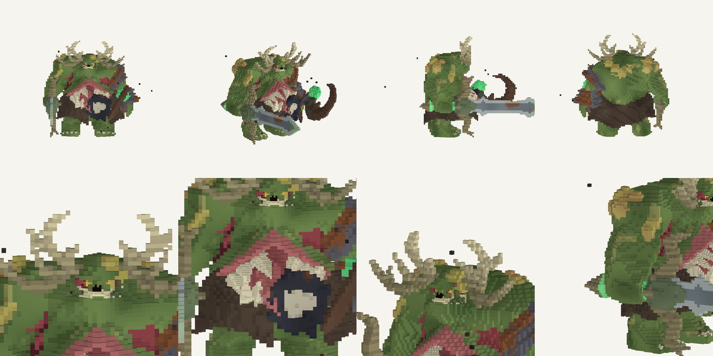

# Great Unclean One — аддон для Minecraft Bedrock

Босс **Great Unclean One** (Warhammer / Нургл), сконвертированный из модели Warcraft III (`.mdx`) в нативную геометрию Bedrock
со скелетом и анимациями. *Converted from a Warcraft III `.mdx` into native Bedrock entity geometry, skeleton and animations.*



## Что внутри

| | |
|---|---|
| `resource_pack/` | геометрия `great_unclean_one.geo.json`, текстура 1024², анимации, контроллер анимаций, render controller, клиентская сущность, локализация (en_US, ru_RU) |
| `behavior_pack/` | сущность `warcraft:great_unclean_one` (босс, 500 HP, ядовитая атака), лут |
| `great_unclean_one.mcaddon` | оба пака одним файлом для установки |
| `previews/` | превью: ракурсы, оригинал vs Bedrock, кадры всех анимаций |
| `tools/` | конвертер MDX → Bedrock (Python + numpy + Pillow), валидатор, рендер превью |

Призвать: `/summon warcraft:great_unclean_one` или яйцо призыва в творческом режиме.

## Как учтены детали оригинала

Конвертер не «рисует похожее», а берёт настоящую сетку модели (42 геосета, скелет из 46 костей и 19 хелперов) и переводит её в кубы:

* **Все видимые части модели**: тело, рога с отростками, нарывы на спине и плечах, зубастая пасть-живот с клыками, шипастый шар-цеп на цепи,
  огромный меч с гардой и самоцветами, крюк, набедренная повязка, когти на стопах, лицо с глазами, бровями и зубами.
* **Рой мух** (5 штук) — отдельная анимация `flies`: кружат вокруг тела по глобальной последовательности оригинала (1,233 с, зациклена).
* **Скрытые в обычных секвенциях части** (гниение, портретный фон, аддитивные эффекты) не включены — в игре они не видны.
* **Скелет** сохранён 1 к 1 (54 кости Bedrock), пивоты и иерархия — из оригинала.
* **Анимации** — из оригинальных секвенций: `walk`, `idle_a/idle_b` (Stand 1/2), `channel` (Stand Channel), `attack_a/attack_b`, `slam` (Spell Slam), `death`.
  Позиции, вращения (кватернионы → углы Bedrock) и масштабы кость в кость; ключи берутся из оригинала, длинные дуги вращения дробятся.
* **Разрешение**: ячейка 1 ед. (1 «пиксель» Minecraft) для гладких частей и 0,5 ед. для мелких деталей (зубы, клыки в животе, глаза, брови, мухи).
  В итоге 7280 кубов, у граней, которые не видны, UV не задаётся (они не рисуются и не занимают место в текстуре).
* Масштаб: 1 ед. WC3 = 0,35 ед. Bedrock; высота модели ≈ 4,3 блока.

## Текстура

В `.mdx` лежат только *имена* стандартных текстур Warcraft III (`Abomination.blp`, `Skeleton.blp` …), самих картинок в файле нет,
поэтому текстура **нарисована процедурно** по материалам геосетов: тёмно-зелёная кожа, бордовая полость живота, костяные рога/клыки,
ржавое железо меча и цепи, самоцветы. Цвета подобраны под вид оригинальной модели в сравнении `previews/03_original_vs_bedrock.png`.
Каждая видимая грань куба = 1 тексель, с затравочной окклюзией; вокруг граней сделан отступ 1 тексель против протекания при мип-маппинге.

## Что проверено, а что нет

Проверено:
* Структура паков (`python3 tools/validate.py`): кости, родители, UV внутри атласа, ссылки анимаций/контроллера/сущностей, манифесты.
* **Блокбенч**: итоговые файлы загружены в реальный Blockbench; соглашения Bedrock (вращения, сдвиги, масштаб, ориентация UV у `up`/`down`,
  зеркальность оси X) измерены на нём численно, а позы всех анимаций совпадают с превью с точностью до 0,02 ед.

**Не проверено в самой игре** (клиента Minecraft здесь не было): поведение контроллера анимаций (переходы по `variable.attack_time`,
`query.ground_speed`), синхронизация шага `anim_time_update`, ускоренная смерть (моб исчезает примерно через секунду), производительность
7,3 тыс. кубов на слабых устройствах. Если что-то выглядит не так — это правится в `tools/pack.py` (контроллер) и `tools/anim.py` (анимации).

## Установка

Скопируйте `resource_pack/` и `behavior_pack/` в `development_resource_packs/` и `development_behavior_packs/` Minecraft Bedrock,
либо откройте `great_unclean_one.mcaddon`. Включите оба пака в мире.

## Пересборка

```bash
pip install numpy pillow
python3 tools/build.py путь/к/GreatUncleanOne.mdx   # геометрия, текстура, анимации, файлы аддона
python3 tools/validate.py                            # проверка структуры
python3 tools/previews.py                            # превью и иконки
python3 tools/compare.py путь/к/GreatUncleanOne.mdx previews/03_original_vs_bedrock.png
```

Исходный `.mdx` в репозиторий не добавлен (права на модель принадлежат её авторам); `tools/build.py` принимает путь к нему аргументом.
